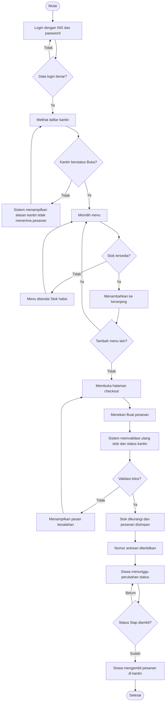
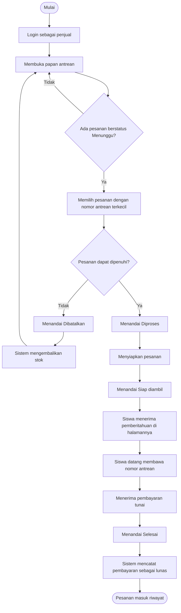
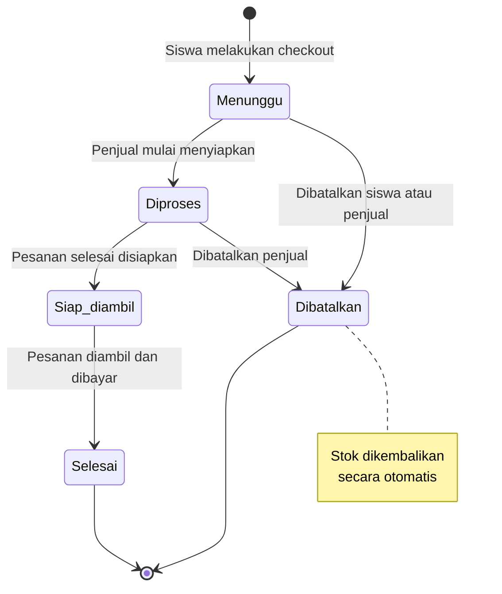
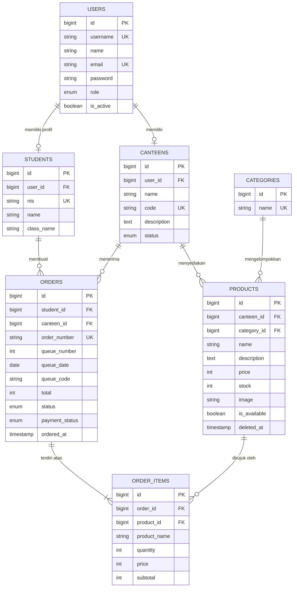

# Dokumentasi Project E-Kantin

Aplikasi Pemesanan Kantin Sekolah Berbasis Web dengan Fitur Antrean Digital

Disusun sebagai laporan Praktik Kerja Lapangan
Program Keahlian Rekayasa Perangkat Lunak

---

## Daftar isi

1. [Latar belakang](#1-latar-belakang)
2. [Identifikasi masalah](#2-identifikasi-masalah)
3. [Rumusan masalah](#3-rumusan-masalah)
4. [Tujuan](#4-tujuan)
5. [Manfaat](#5-manfaat)
6. [Target pengguna](#6-target-pengguna)
7. [Fitur sistem](#7-fitur-sistem)
8. [Design Thinking](#8-design-thinking)
9. [SDLC](#9-sdlc)
10. [Use case](#10-use-case)
11. [Activity diagram](#11-activity-diagram)
12. [ERD dan relasi database](#12-erd-dan-relasi-database)
13. [Teknologi yang digunakan](#13-teknologi-yang-digunakan)
14. [Struktur folder](#14-struktur-folder)
15. [Screenshot halaman](#15-screenshot-halaman)
16. [Testing](#16-testing)
17. [Kesimpulan](#17-kesimpulan)
18. [Pengembangan selanjutnya](#18-pengembangan-selanjutnya)

> Diagram di dokumen ini ditulis dengan sintaks Mermaid. Diagram akan tampil otomatis di GitHub dan di VS Code dengan ekstensi Markdown Preview Mermaid Support. Untuk laporan cetak, salin kode diagramnya ke mermaid.live lalu ekspor sebagai PNG.

---

## 1. Latar belakang

Waktu istirahat di sekolah menengah umumnya hanya 15 sampai 30 menit. Dalam rentang sesingkat itu, ratusan siswa bergerak serentak menuju kantin. Hasilnya adalah antrean panjang yang menghabiskan sebagian besar waktu istirahat hanya untuk menunggu giliran dipesan dan dilayani.

Dari sisi penjual, masalahnya berbeda tapi saling terkait. Pesanan datang bertumpuk secara lisan, sehingga penjual harus mengingat siapa memesan apa sambil tetap memasak. Kekeliruan urutan dan pesanan tertukar menjadi hal yang biasa. Selain itu, penjual tidak punya catatan penjualan yang rapi karena semua transaksi dicatat manual atau tidak dicatat sama sekali.

Sekolah sendiri tidak memiliki gambaran menyeluruh tentang aktivitas kantin: berapa transaksi yang terjadi, kantin mana yang ramai, dan menu apa yang paling banyak dipesan.

Teknologi web dan ponsel pintar yang sudah dimiliki hampir seluruh siswa membuka peluang untuk memindahkan proses pemesanan dari antrean fisik ke antrean digital. Siswa memesan lebih dulu dari kelas atau dari mana saja, lalu datang ke kantin hanya pada saat pesanannya sudah siap.

---

## 2. Identifikasi masalah

| Kode | Masalah | Pihak terdampak |
|---|---|---|
| M-01 | Antrean panjang menghabiskan waktu istirahat siswa | Siswa |
| M-02 | Siswa tidak tahu apakah menu yang diinginkan masih tersedia sebelum sampai di kantin | Siswa |
| M-03 | Siswa tidak tahu kantin mana yang sedang buka atau tutup | Siswa |
| M-04 | Pesanan lisan yang bertumpuk menyebabkan urutan tertukar | Penjual dan siswa |
| M-05 | Penjual kesulitan memantau stok sambil melayani pembeli | Penjual |
| M-06 | Tidak ada catatan transaksi yang rapi dan dapat ditelusuri | Penjual dan sekolah |
| M-07 | Penjual tidak punya cara resmi memberi tahu bahwa kantin sedang tutup | Penjual |
| M-08 | Sekolah tidak punya gambaran menyeluruh atas aktivitas seluruh kantin | Sekolah |

---

## 3. Rumusan masalah

1. Bagaimana merancang sistem pemesanan kantin sekolah yang memungkinkan siswa memesan tanpa harus mengantre secara fisik?
2. Bagaimana membangun sistem antrean digital yang nomornya urut per kantin dan mudah dipahami baik oleh siswa maupun penjual?
3. Bagaimana memastikan data stok selalu akurat sehingga siswa tidak dapat memesan menu yang sudah habis, termasuk ketika beberapa siswa memesan dalam waktu bersamaan?
4. Bagaimana menyediakan informasi status kantin secara jelas kepada siswa, sekaligus memberi penjual kendali untuk menutup atau membuka penerimaan pesanan?
5. Bagaimana menyimpan riwayat transaksi sehingga data historis tetap utuh meskipun data menu diubah di kemudian hari?
6. Bagaimana memisahkan hak akses tiga jenis pengguna agar data masing-masing pihak tetap aman?

---

## 4. Tujuan

**Tujuan umum.** Membangun aplikasi web pemesanan kantin sekolah yang mengurangi waktu tunggu siswa dan merapikan pengelolaan kantin.

**Tujuan khusus.**

1. Menghasilkan aplikasi berbasis Laravel dan MySQL yang dapat digunakan tiga jenis pengguna dengan hak akses berbeda.
2. Menerapkan sistem antrean digital bernomor urut per kantin yang di-reset setiap hari.
3. Menerapkan pengurangan stok otomatis saat pemesanan, dilengkapi penguncian basis data agar stok tidak pernah menjadi negatif.
4. Menyediakan pengaturan status kantin dengan tiga pilihan yang secara langsung mempengaruhi kemampuan siswa membuat pesanan.
5. Menyimpan riwayat transaksi lengkap dengan harga pada saat transaksi dilakukan.
6. Menghasilkan antarmuka yang dapat digunakan dengan nyaman pada layar ponsel.

---

## 5. Manfaat

**Bagi siswa.** Waktu istirahat lebih banyak terpakai untuk makan dan beristirahat, bukan untuk mengantre. Informasi stok dan status kantin tersedia sebelum siswa beranjak dari kelas.

**Bagi penjual.** Pesanan masuk dalam bentuk daftar tertulis yang berurutan, sehingga tidak ada lagi pesanan tertukar. Stok dan penjualan tercatat otomatis tanpa perlu pembukuan manual.

**Bagi sekolah.** Tersedia data aktivitas kantin yang dapat dijadikan dasar pengambilan keputusan, misalnya menentukan perlu tidaknya menambah kantin atau memperpanjang waktu istirahat.

**Bagi penyusun.** Penerapan langsung materi pemrograman web, basis data, dan rekayasa perangkat lunak pada kasus nyata di lingkungan sekolah.

---

## 6. Target pengguna

| Pengguna | Jumlah perkiraan | Perangkat utama | Kebutuhan utama |
|---|---|---|---|
| Siswa | Ratusan | Ponsel | Memesan cepat, tahu nomor antrean, tahu kapan pesanan siap |
| Penjual kantin | 2 sampai 5 orang | Ponsel atau tablet di meja kantin | Melihat antrean, mengubah status pesanan, mengatur stok |
| Admin sekolah | 1 orang | Laptop | Mengelola data master dan memantau seluruh kantin |

Karena mayoritas pengguna adalah siswa yang mengakses lewat ponsel, seluruh antarmuka dirancang dengan pendekatan *mobile first*. Tampilan desktop merupakan pengembangan dari tampilan ponsel, bukan sebaliknya.

---

## 7. Fitur sistem

### 7.1 Fitur siswa

| Fitur | Keterangan |
|---|---|
| Login | Menggunakan NIS dan password |
| Daftar kantin | Lengkap dengan indikator status buka, tutup sementara, atau tutup |
| Pencarian | Mencari kantin dan mencari menu di dalam kantin |
| Daftar dan detail menu | Foto, deskripsi, harga, sisa stok |
| Keranjang | Menambah, mengubah jumlah, dan menghapus item |
| Checkout | Ringkasan pesanan dan pembuatan pesanan |
| Nomor antrean | Ditampilkan besar sebagai elemen utama halaman pesanan |
| Pelacakan status | Diperbarui otomatis setiap 7 detik |
| Pembatalan | Hanya selama pesanan masih berstatus Menunggu |
| Riwayat pesanan | Beserta detail lengkap tiap transaksi |
| Ganti password | Untuk keamanan akun pribadi |

### 7.2 Fitur penjual

| Fitur | Keterangan |
|---|---|
| Dashboard | Jumlah pesanan per status, pemasukan hari ini, daftar stok menipis |
| CRUD menu | Tambah, ubah, hapus, termasuk unggah foto |
| Ubah stok cepat | Langsung dari halaman daftar menu tanpa membuka form edit |
| Aktif atau nonaktif menu | Menyembunyikan menu dari siswa tanpa menghapusnya |
| Daftar pesanan masuk | Dapat difilter berdasarkan status |
| Ubah status pesanan | Mengikuti alur yang sudah ditentukan |
| Papan antrean | Tiga kolom: Menunggu, Diproses, Siap diambil |
| Pengaturan status kantin | Tiga pilihan status |
| Riwayat transaksi | Dengan filter rentang tanggal dan total pemasukan |

### 7.3 Fitur admin

| Fitur | Keterangan |
|---|---|
| Dashboard | Statistik menyeluruh dan kondisi semua kantin |
| CRUD siswa | Termasuk pembuatan akun login otomatis |
| CRUD penjual | Termasuk pengaktifan dan penonaktifan akun |
| CRUD kantin | Termasuk penetapan kode antrean dan pemilik kantin |
| CRUD kategori | Kategori dipakai bersama oleh seluruh kantin |
| Pemantauan menu | Seluruh menu dari semua kantin |
| Pemantauan pesanan | Dengan filter kantin, status, dan tanggal |

### 7.4 Empat fitur pembeda

**Smart Queue.** Setiap pesanan memperoleh nomor antrean berformat kode kantin diikuti tiga digit, misalnya A027. Nomor berjalan urut per kantin dan dimulai kembali dari 001 setiap hari. Keunikan nomor dijaga oleh *unique index* pada kombinasi kantin, tanggal, dan nomor, sehingga dua pesanan yang dibuat bersamaan tidak mungkin memperoleh nomor yang sama.

**Stok akurat.** Stok berkurang pada saat pesanan dibuat, bukan saat pesanan selesai. Seluruh proses checkout berjalan di dalam satu *database transaction* dengan `lockForUpdate()` pada baris produk. Bila dua siswa memesan menu terakhir secara bersamaan, hanya satu yang berhasil dan yang lain menerima pesan stok tidak mencukupi.

**Status kantin.** Tiga status dengan perilaku berbeda. Buka berarti pesanan diterima. Tutup sementara berarti menu tetap terlihat tetapi pesanan baru ditolak, cocok untuk keadaan penjual sedang mengisi ulang bahan. Tutup berarti kantin tidak beroperasi.

**Riwayat yang tidak berubah.** Tabel `order_items` menyimpan nama dan harga menu apa adanya pada saat transaksi. Jika penjual menaikkan harga esok harinya, riwayat pesanan kemarin tetap menampilkan harga lama. Hal ini penting agar laporan penjualan tetap dapat dipertanggungjawabkan.

---

## 8. Design Thinking

### 8.1 Empathize

Pengamatan dan wawancara singkat dilakukan terhadap siswa dan penjual kantin pada jam istirahat.

**Temuan dari siswa.** Waktu mengantre berkisar 8 sampai 15 menit dari total 20 menit istirahat. Sering terjadi siswa sudah mengantre lama tetapi menu yang diinginkan ternyata habis. Siswa yang kelasnya jauh dari kantin hampir selalu kebagian antrean paling belakang.

**Temuan dari penjual.** Penjual harus mengingat pesanan lisan sambil memasak. Saat ramai, penjual kesulitan mengetahui bahan mana yang hampir habis. Tidak ada cara memberi tahu siswa saat kantin tutup selain memasang tulisan di meja.

**Pernyataan pengguna yang dijadikan acuan.**

> "Kadang sudah antre lama, pas giliran saya ternyata nasi gorengnya habis." — siswa kelas XI

> "Saya sering lupa siapa pesan duluan kalau lagi ramai." — penjual kantin

### 8.2 Define

Empat masalah inti dirumuskan dari hasil tahap Empathize.

1. Siswa membuang waktu istirahat untuk berdiri dalam antrean.
2. Informasi ketersediaan menu baru diketahui setelah sampai di depan penjual.
3. Urutan pesanan tidak terdokumentasi sehingga rawan tertukar.
4. Tidak ada saluran resmi untuk memberitahukan status kantin.

**Pernyataan masalah.** Siswa membutuhkan cara memesan makanan tanpa berdiri dalam antrean, dan penjual membutuhkan daftar pesanan yang berurutan serta tercatat, agar waktu istirahat dapat dimanfaatkan untuk makan dan bukan untuk menunggu.

### 8.3 Ideate

| Gagasan | Keputusan | Alasan |
|---|---|---|
| Pemesanan lewat web dari ponsel | Dipakai | Tidak perlu instalasi, semua siswa sudah punya browser |
| Nomor antrean digital per kantin | Dipakai | Menggantikan urutan lisan dengan urutan tertulis |
| Indikator stok waktu nyata | Dipakai | Mencegah siswa memesan menu yang habis |
| Indikator status kantin | Dipakai | Menjawab kebutuhan penjual akan saluran pengumuman |
| Aplikasi Android | Tidak dipakai | Kebutuhan instalasi menjadi hambatan tersendiri |
| Pembayaran elektronik | Tidak dipakai pada tahap ini | Memerlukan kerja sama pihak ketiga dan izin sekolah |
| Notifikasi push ke ponsel | Diganti dengan pembaruan otomatis halaman | Notifikasi push memerlukan infrastruktur tambahan yang tidak sebanding dengan manfaatnya untuk kasus ini |

### 8.4 Prototype

Prototipe disusun sebagai rangkaian layar dengan alur berikut.

```
Login → Daftar kantin → Daftar menu → Detail menu → Keranjang
      → Checkout → Nomor antrean → Riwayat pesanan
```

Keputusan desain yang diambil pada tahap ini.

- Nomor antrean ditempatkan sebagai elemen terbesar pada halaman pesanan, karena itulah satu-satunya informasi yang dibutuhkan siswa saat menghampiri kantin.
- Warna oranye dipilih sebagai warna utama karena berasosiasi dengan makanan dan bersifat hangat, sekaligus mudah dibedakan dari warna status hijau, kuning, dan merah.
- Navigasi bawah tiga tombol dipakai pada layar ponsel, mengikuti kebiasaan pengguna aplikasi pesan-antar makanan.
- Status ditandai dengan lencana berwarna sekaligus bertuliskan keterangan, bukan warna saja, agar tetap terbaca oleh pengguna dengan keterbatasan penglihatan warna.

### 8.5 Test

| Yang diuji | Cara | Hasil dan perbaikan |
|---|---|---|
| Kejelasan nomor antrean | Menunjukkan halaman kepada beberapa siswa | Ukuran huruf nomor antrean diperbesar dan diberi latar berwarna |
| Pemahaman status kantin | Menanyakan arti tiap lencana | Keterangan diubah dari singkatan menjadi kata utuh |
| Alur checkout | Meminta pengguna memesan tanpa dipandu | Tombol checkout dinonaktifkan secara jelas ketika kantin tutup, disertai penjelasan sebabnya |
| Pemesanan bersamaan | Dua pesanan atas menu terakhir secara serempak | Ditemukan risiko stok minus, diatasi dengan transaction dan lockForUpdate |

---

## 9. SDLC

Model yang digunakan adalah **Waterfall dengan iterasi terbatas**, dipilih karena kebutuhan sistem sudah cukup jelas sejak awal dan lingkup pekerjaan tidak terlalu luas.

### 9.1 Requirement Analysis

Kebutuhan dikumpulkan lewat pengamatan dan wawancara, lalu dipisahkan menjadi dua kelompok.

**Kebutuhan fungsional.** Autentikasi tiga role, CRUD menu, keranjang dan checkout, pengurangan stok otomatis, nomor antrean, perubahan status pesanan, pengaturan status kantin, riwayat transaksi, dan dashboard.

**Kebutuhan non-fungsional.** Antarmuka dapat digunakan pada layar ponsel, password tersimpan dalam bentuk hash, halaman terlindungi sesuai role, stok tidak boleh negatif, dan riwayat transaksi tidak boleh berubah nilainya.

### 9.2 Design

Perancangan mencakup struktur basis data (delapan tabel inti), pembagian peran dan hak akses, alur proses utama, serta rancangan antarmuka.

Tiga keputusan perancangan yang paling berpengaruh.

**Satu tabel users untuk semua role.** Alternatifnya adalah memisahkan tabel siswa dari tabel pengguna dan memakai *multi guard authentication*. Pilihan satu tabel diambil karena membuat proses autentikasi menjadi sederhana: satu guard, satu middleware, satu alur login. Data khusus siswa seperti NIS dan kelas ditempatkan pada tabel `students` yang berelasi satu ke satu dengan `users`.

**Kantin dimiliki oleh user, bukan menyimpan nama penjual sebagai teks.** Kolom `canteens.user_id` merupakan kunci tamu menuju tabel `users`. Tanpa relasi ini, sistem tidak dapat memverifikasi bahwa seorang penjual hanya mengelola kantinnya sendiri.

**Nomor antrean disimpan di tabel orders.** Alternatifnya adalah membuat tabel `queue_numbers` tersendiri. Pilihan ini ditolak karena tabel `orders` sudah memiliki kolom status; menyimpan status di dua tempat akan menciptakan dua sumber kebenaran yang cepat atau lambat menjadi tidak sinkron.

### 9.3 Implementation

Pengerjaan dilakukan bertahap agar setiap bagian dapat diuji sebelum melanjutkan.

| Tahap | Pekerjaan |
|---|---|
| 1 | Migration, model, dan relasi antar tabel |
| 2 | Autentikasi dan middleware role |
| 3 | CRUD menu oleh penjual |
| 4 | Keranjang, checkout, dan pengurangan stok |
| 5 | Nomor antrean dan alur status pesanan |
| 6 | Dashboard dan riwayat |
| 7 | Penyempurnaan antarmuka dan penyesuaian tampilan ponsel |

Standar kode yang diterapkan: struktur direktori bawaan Laravel, penamaan sesuai konvensi Laravel, logika bisnis yang kompleks dipindahkan ke kelas *service* agar tidak menumpuk di controller, dan validasi masukan ditempatkan pada *form request* atau method `validate`.

### 9.4 Testing

Pengujian dilakukan dengan dua cara. **Pengujian manual** memakai daftar periksa 40 butir yang mencakup seluruh alur utama, tersedia pada README bagian Step 9. **Pengujian otomatis** ditulis untuk aturan yang paling kritis, yaitu pengurangan stok setelah checkout dan penolakan pesanan yang melebihi stok, terletak di `tests/Feature/CheckoutTest.php`.

### 9.5 Deployment

Aplikasi dapat dijalankan secara lokal memakai Laragon atau XAMPP untuk keperluan demonstrasi, atau dipasang di server sekolah maupun layanan hosting yang mendukung PHP 8.2 dan MySQL. Langkah pemasangan lengkap tersedia di README.

### 9.6 Maintenance

Pemeliharaan yang direncanakan meliputi pencadangan basis data secara berkala, pembaruan versi Laravel ketika tersedia rilis keamanan, penambahan menu dan kantin baru sesuai kebutuhan sekolah, serta peninjauan laporan penjualan setiap akhir bulan.

---

## 10. Use case

```mermaid
graph TB
    Siswa(( Siswa ))
    Penjual(( Penjual ))
    Admin(( Admin ))

    subgraph Sistem E-Kantin
        UC1[Login]
        UC2[Melihat daftar kantin]
        UC3[Melihat dan mencari menu]
        UC4[Mengelola keranjang]
        UC5[Melakukan checkout]
        UC6[Melihat nomor antrean]
        UC7[Melacak status pesanan]
        UC8[Melihat riwayat pesanan]
        UC9[Membatalkan pesanan]

        UC10[Mengelola menu]
        UC11[Mengatur stok]
        UC12[Mengatur status kantin]
        UC13[Melihat pesanan masuk]
        UC14[Mengubah status pesanan]
        UC15[Melihat papan antrean]
        UC16[Melihat riwayat transaksi]

        UC17[Mengelola data siswa]
        UC18[Mengelola data penjual]
        UC19[Mengelola data kantin]
        UC20[Mengelola kategori]
        UC21[Memantau seluruh kantin]
    end

    Siswa --> UC1
    Siswa --> UC2
    Siswa --> UC3
    Siswa --> UC4
    Siswa --> UC5
    Siswa --> UC6
    Siswa --> UC7
    Siswa --> UC8
    Siswa --> UC9

    Penjual --> UC1
    Penjual --> UC10
    Penjual --> UC11
    Penjual --> UC12
    Penjual --> UC13
    Penjual --> UC14
    Penjual --> UC15
    Penjual --> UC16

    Admin --> UC1
    Admin --> UC17
    Admin --> UC18
    Admin --> UC19
    Admin --> UC20
    Admin --> UC21
```



### Skenario use case utama: Melakukan checkout

| Bagian | Isi |
|---|---|
| Nama | Melakukan checkout |
| Aktor | Siswa |
| Prasyarat | Siswa sudah login, keranjang berisi minimal satu menu, kantin berstatus Buka |
| Alur utama | 1. Siswa membuka halaman keranjang<br>2. Sistem menampilkan daftar menu, jumlah, subtotal, dan total<br>3. Siswa menekan Lanjut ke checkout<br>4. Sistem menampilkan ringkasan pesanan<br>5. Siswa menekan Buat pesanan<br>6. Sistem memulai database transaction<br>7. Sistem mengunci baris kantin dan baris produk terkait<br>8. Sistem memeriksa status kantin dan kecukupan stok<br>9. Sistem mengurangi stok setiap produk<br>10. Sistem menghitung nomor antrean berikutnya<br>11. Sistem menyimpan pesanan beserta rinciannya<br>12. Sistem mengosongkan keranjang dan menutup transaction<br>13. Sistem menampilkan nomor antrean kepada siswa |
| Alur alternatif A | Pada langkah 8 kantin ternyata tidak berstatus Buka. Sistem membatalkan transaction dan menampilkan pesan bahwa kantin sedang tutup. |
| Alur alternatif B | Pada langkah 8 stok tidak mencukupi. Sistem membatalkan transaction dan menampilkan sisa stok yang tersedia. |
| Kondisi akhir | Pesanan tersimpan, stok berkurang, siswa memperoleh nomor antrean |

---

## 11. Activity diagram

### 11.1 Proses pemesanan oleh siswa



### 11.2 Proses pengelolaan pesanan oleh penjual



### 11.3 Alur status pesanan



Perpindahan status dibatasi oleh method `allowedNextStatuses()` pada model `Order`, sehingga lompatan yang tidak masuk akal seperti dari Selesai kembali ke Menunggu tidak dimungkinkan.

---

## 12. ERD dan relasi database

### 12.1 Entity Relationship Diagram



### 12.2 Penjelasan relasi

| Relasi | Jenis | Keterangan |
|---|---|---|
| users → students | Satu ke satu | Hanya pengguna dengan role siswa yang memiliki baris di tabel students |
| users → canteens | Satu ke satu | Satu penjual mengelola tepat satu kantin |
| canteens → products | Satu ke banyak | Menu selalu melekat pada satu kantin |
| categories → products | Satu ke banyak | Kategori bersifat opsional, dapat bernilai kosong |
| students → orders | Satu ke banyak | Seluruh riwayat pesanan seorang siswa |
| canteens → orders | Satu ke banyak | Seluruh pesanan yang masuk ke sebuah kantin |
| orders → order_items | Satu ke banyak | Rincian menu dalam satu pesanan |
| products → order_items | Satu ke banyak | Bersifat opsional agar riwayat tetap utuh bila produk dihapus |

### 12.3 Keputusan perancangan basis data

**Harga disimpan sebagai integer.** Rupiah tidak memiliki satuan pecahan yang dipakai sehari-hari di kantin, sementara tipe data pecahan seperti `float` menimbulkan galat pembulatan. Nilai 15000 disimpan apa adanya sebagai bilangan bulat.

**Snapshot pada order_items.** Kolom `product_name` dan `price` menduplikasi data dari tabel `products`. Duplikasi ini disengaja, karena riwayat transaksi harus mencerminkan keadaan pada saat transaksi terjadi, bukan keadaan terkini.

**Soft delete pada products.** Ketika penjual menghapus menu, baris tidak benar-benar dihapus melainkan hanya ditandai. Dengan begitu relasi ke `order_items` tetap utuh dan riwayat tidak rusak.

**Unique index pada antrean.** Index `orders_queue_unique` mencakup kombinasi `canteen_id`, `queue_date`, dan `queue_number`. Index inilah yang menjadi jaminan terakhir bahwa dua pesanan tidak akan pernah memiliki nomor antrean yang sama pada kantin dan hari yang sama, bahkan ketika terjadi pemesanan serempak.

**Zona waktu Asia/Jakarta.** Ditetapkan pada `config/app.php`. Tanpa penetapan ini, Laravel memakai UTC sehingga nomor antrean akan ter-reset pada pukul tujuh pagi waktu Indonesia, tepat di tengah jam operasional sekolah.

---

## 13. Teknologi yang digunakan

| Lapisan | Teknologi | Versi | Alasan pemilihan |
|---|---|---|---|
| Bahasa | PHP | 8.2 | Bahasa yang dipelajari di sekolah dan didukung luas oleh hosting |
| Framework | Laravel | 11 | Menyediakan ORM, migration, validasi, dan keamanan bawaan |
| Basis data | MySQL | 5.7 ke atas | Umum dipakai dan tersedia pada Laragon maupun XAMPP |
| Template | Blade | bawaan Laravel | Terintegrasi penuh dengan Laravel |
| CSS | Tailwind CSS | 3.4 | Memudahkan pembuatan tampilan responsif tanpa menulis banyak CSS terpisah |
| Bundler | Vite | 6 | Bawaan Laravel, proses build cepat |
| JavaScript | JavaScript murni | ES6 | Kebutuhan interaksi sedikit, sehingga tidak perlu framework tambahan |
| ORM | Eloquent | bawaan Laravel | Relasi antar tabel dapat ditulis secara ringkas dan terbaca |

### Fitur Laravel yang dimanfaatkan

| Fitur | Penerapan |
|---|---|
| Eloquent ORM | Seluruh akses data dan relasi antar tabel |
| Migration | Pembuatan struktur tabel yang dapat diulang di komputer mana pun |
| Seeder | Pengisian data demo |
| Middleware | Pembatasan akses berdasarkan role |
| Form Request | Validasi masukan form menu |
| Blade component | Lencana status, notifikasi, dan gambar menu yang dipakai berulang |
| Database transaction | Menjaga konsistensi stok saat checkout |
| Pessimistic locking | `lockForUpdate()` untuk mencegah stok negatif |
| Soft delete | Penghapusan menu tanpa merusak riwayat |
| CSRF protection | Aktif secara otomatis pada seluruh form |
| Password hashing | Melalui cast `hashed` pada model User |
| Rate limiting | Pembatasan sepuluh percobaan login per menit |

---

## 14. Struktur folder

```
E-Kantin/
├── app/
│   ├── Http/
│   │   ├── Controllers/
│   │   │   ├── Auth/              LoginController, PasswordController
│   │   │   ├── Student/           Dashboard, Canteen, Product, Cart, Checkout, Order
│   │   │   ├── Seller/            Dashboard, Product, Order, Queue, CanteenStatus, History
│   │   │   └── Admin/             Dashboard, Student, Seller, Canteen, Category, Product, Order
│   │   ├── Middleware/            EnsureUserHasRole
│   │   └── Requests/              ProductRequest
│   ├── Models/                    User, Student, Canteen, Category, Product, Order, OrderItem
│   ├── Services/                  OrderService
│   ├── Support/                   Cart, helpers
│   └── Providers/                 AppServiceProvider
├── bootstrap/                     app.php, providers.php
├── config/                        app, auth, database, filesystems, session, cache, dan lainnya
├── database/
│   ├── migrations/                Delapan berkas migration
│   └── seeders/                   Admin, Category, Canteen, Student, Product
├── public/                        index.php, .htaccess, build
├── resources/
│   ├── css/                       app.css
│   ├── js/                        app.js
│   └── views/                     layouts, components, auth, student, seller, admin
├── routes/                        web.php, console.php
├── storage/                       app, framework, logs
├── tests/Feature/                 CheckoutTest
├── .env.example
├── composer.json
├── package.json
├── tailwind.config.js
├── vite.config.js
├── README.md
└── PROJECT_DOCUMENTATION.md
```

### Pembagian tanggung jawab

Pemisahan tanggung jawab mengikuti pola Model View Controller dengan satu lapisan tambahan.

**Model** menangani representasi data dan relasi, ditambah aturan sederhana seperti `isOrderable()` dan `statusLabel()`.

**View** hanya menampilkan data. Tidak ada kueri basis data di dalam berkas Blade.

**Controller** menerima permintaan, melakukan validasi, memanggil model atau service, lalu mengembalikan tampilan. Setiap controller sengaja dibuat pendek.

**Service** menampung aturan bisnis yang rumit. `OrderService` menjadi satu-satunya tempat logika checkout ditulis, sehingga aturan stok dan antrean tidak tersebar di banyak berkas.

---

## 15. Screenshot halaman

Bagian ini diisi setelah aplikasi berhasil dijalankan di komputer masing-masing. Simpan berkas gambar di folder `docs/screenshots/`, lalu ganti tanda kurung siku di bawah dengan sintaks gambar Markdown, contohnya ``.

| No | Halaman | Yang perlu terlihat | Berkas |
|---|---|---|---|
| 1 | Login | Panel oranye dan form login | `01-login.png` |
| 2 | Dashboard siswa | Sapaan, daftar kantin, lencana status | `02-dashboard-siswa.png` |
| 3 | Daftar menu | Kartu menu dengan foto, harga, dan stok | `03-daftar-menu.png` |
| 4 | Detail menu | Foto besar, deskripsi, pemilih jumlah | `04-detail-menu.png` |
| 5 | Keranjang | Daftar item, subtotal, total | `05-keranjang.png` |
| 6 | Checkout | Ringkasan pesanan | `06-checkout.png` |
| 7 | Nomor antrean | Nomor besar dan lencana status | `07-antrean.png` |
| 8 | Riwayat pesanan | Daftar transaksi dengan tanggal | `08-riwayat.png` |
| 9 | Dashboard penjual | Empat kartu jumlah pesanan dan tabel stok menipis | `09-dashboard-penjual.png` |
| 10 | Kelola menu | Kartu menu dengan kotak ubah stok | `10-kelola-menu.png` |
| 11 | Papan antrean | Tiga kolom status | `11-papan-antrean.png` |
| 12 | Status kantin | Tiga pilihan status | `12-status-kantin.png` |
| 13 | Riwayat penjual | Filter tanggal dan total pemasukan | `13-riwayat-penjual.png` |
| 14 | Dashboard admin | Kartu statistik dan tabel kantin | `14-dashboard-admin.png` |
| 15 | Kelola siswa | Tabel data siswa | `15-kelola-siswa.png` |
| 16 | Kelola kantin | Tabel kantin dengan kode antrean | `16-kelola-kantin.png` |
| 17 | Tampilan ponsel | Navigasi bawah tiga tombol | `17-mobile.png` |

**Cara mengambil tangkapan layar tampilan ponsel:** buka aplikasi di browser, tekan F12, klik ikon ponsel di pojok kiri atas panel yang muncul, pilih perangkat iPhone atau Pixel, lalu ambil tangkapan layar seperti biasa.

---

## 16. Testing

### 16.1 Pengujian fungsional

Tabel berikut adalah ringkasan. Daftar periksa lengkap 40 butir tersedia di README bagian Step 9.

| Kode | Skenario | Masukan | Keluaran yang diharapkan | Hasil |
|---|---|---|---|---|
| T-01 | Login benar | `2024001` / `password` | Masuk ke dashboard siswa | |
| T-02 | Login salah | `2024001` / `salah` | Pesan data login tidak ditemukan | |
| T-03 | Siswa membuka halaman admin | URL `/admin/dashboard` | Halaman 403 | |
| T-04 | Penjual membuka halaman admin | URL `/admin/students` | Halaman 403 | |
| T-05 | Tambah menu | Data lengkap dan foto | Menu muncul di daftar | |
| T-06 | Edit harga menu | Harga 15000 menjadi 17000 | Harga berubah di tampilan siswa | |
| T-07 | Hapus menu | Klik hapus lalu setujui | Menu hilang, riwayat lama tetap ada | |
| T-08 | Checkout normal | 2 porsi dari stok 20 | Pesanan terbuat, stok menjadi 18 | |
| T-09 | Checkout melebihi stok | 5 porsi dari stok 3 | Pesan stok tidak mencukupi | |
| T-10 | Checkout saat kantin tutup | Status kantin Tutup | Tombol checkout nonaktif | |
| T-11 | Nomor antrean pertama | Pesanan pertama kantin A | Nomor A001 | |
| T-12 | Nomor antrean berikutnya | Pesanan kedua kantin A | Nomor A002 | |
| T-13 | Nomor antrean kantin lain | Pesanan pertama kantin B | Nomor B001, bukan A003 | |
| T-14 | Ubah status pesanan | Menunggu menjadi Diproses | Status berubah di halaman siswa | |
| T-15 | Pemberitahuan siap diambil | Status diubah ke Siap diambil | Halaman siswa berubah sendiri dalam 7 detik | |
| T-16 | Batalkan pesanan | Pesanan berstatus Menunggu | Stok kembali ke jumlah semula | |
| T-17 | Snapshot harga | Ubah harga setelah transaksi | Harga di riwayat tidak berubah | |
| T-18 | Stok habis | Stok diatur menjadi 0 | Menu berlabel Stok habis dan tidak dapat dipesan | |
| T-19 | Ganti password | Password lama benar | Password berhasil diperbarui | |
| T-20 | Tampilan ponsel | Lebar layar 375 piksel | Navigasi bawah muncul, tata letak rapi | |

Kolom Hasil diisi sendiri setelah pengujian dilakukan, dengan keterangan Berhasil atau Gagal disertai catatan bila perlu.

### 16.2 Pengujian otomatis

Berkas `tests/Feature/CheckoutTest.php` berisi dua pengujian.

| Nama pengujian | Yang diperiksa |
|---|---|
| `test_stok_berkurang_setelah_checkout` | Stok awal 10, dipesan 2, stok akhir harus 8 |
| `test_tidak_bisa_memesan_melebihi_stok` | Pesanan 99 porsi dari stok 10 harus ditolak |

Cara menjalankan:

```bash
php artisan test
```

### 16.3 Pengujian keamanan

| Aspek | Penerapan | Cara memeriksa |
|---|---|---|
| Penyimpanan password | Hash bcrypt melalui cast `hashed` | Buka tabel users di phpMyAdmin, kolom password tidak terbaca |
| CSRF | Token `@csrf` pada seluruh form | Kirim form tanpa token, sistem menolak dengan galat 419 |
| Pembatasan akses | Middleware `role` pada seluruh grup rute | Uji T-03 dan T-04 |
| Kepemilikan data | Pemeriksaan `abort_unless` di controller | Buka pesanan siswa lain lewat URL, harus muncul 403 |
| SQL injection | Query builder Eloquent memakai parameter terikat | Masukkan `' OR 1=1--` pada kolom pencarian |
| XSS | Blade melakukan escaping otomatis pada `{{ }}` | Simpan `<script>alert(1)</script>` sebagai nama menu, akan tampil sebagai teks biasa |
| Percobaan login berulang | Rate limit sepuluh kali per menit | Coba login salah sebelas kali berturut-turut |

---

## 17. Kesimpulan

Aplikasi E-Kantin berhasil dibangun sebagai sistem pemesanan kantin sekolah berbasis web yang menjawab keenam rumusan masalah.

**Terhadap rumusan pertama**, siswa kini dapat memesan dari mana saja melalui browser di ponsel, sehingga tidak perlu berdiri dalam antrean fisik sejak awal jam istirahat.

**Terhadap rumusan kedua**, sistem antrean digital diterapkan dengan nomor berformat kode kantin diikuti tiga digit yang berjalan urut per kantin dan dimulai kembali setiap hari. Nomor ditampilkan sebagai elemen terbesar pada halaman siswa dan sebagai kartu besar pada papan antrean penjual.

**Terhadap rumusan ketiga**, akurasi stok dijaga melalui kombinasi database transaction, pessimistic locking, dan validasi berlapis pada saat menambahkan ke keranjang maupun pada saat checkout. Pendekatan ini membuat stok tidak mungkin menjadi negatif sekalipun beberapa siswa memesan menu terakhir secara bersamaan.

**Terhadap rumusan keempat**, status kantin dengan tiga pilihan memberi penjual kendali penuh sekaligus memberi siswa informasi yang jelas sebelum memesan.

**Terhadap rumusan kelima**, riwayat transaksi dijaga keutuhannya melalui penyimpanan snapshot nama dan harga pada tabel `order_items`, ditambah penerapan soft delete pada tabel `products`.

**Terhadap rumusan keenam**, pemisahan hak akses diterapkan melalui satu middleware yang memeriksa kolom role, dilengkapi pemeriksaan kepemilikan data pada tingkat controller.

Di luar pencapaian tersebut, terdapat dua keterbatasan yang perlu dinyatakan secara jujur. **Pertama**, pemberitahuan pesanan siap diambil bekerja dengan cara halaman menanyakan status ke server setiap tujuh detik, bukan melalui push notification. **Kedua**, pembayaran belum terintegrasi secara elektronik dan masih mengandalkan pembayaran tunai pada saat pengambilan.

Secara keseluruhan, project ini memperlihatkan bahwa masalah sehari-hari di lingkungan sekolah dapat diselesaikan dengan teknologi web yang relatif sederhana, sepanjang perancangan basis data dan aturan bisnisnya dipikirkan dengan cermat sejak awal.

---

## 18. Pengembangan selanjutnya

### Prioritas tinggi

**Pembayaran non-tunai.** Integrasi dengan payment gateway atau sistem saldo internal sekolah. Pendekatan saldo lebih sesuai untuk lingkungan sekolah karena orang tua dapat mengisi saldo secara berkala dan pengeluaran anak dapat dipantau. Kolom `payment_status` yang sudah ada dapat langsung dimanfaatkan.

**Pemberitahuan sungguhan.** Mengganti mekanisme polling dengan Laravel Reverb atau Pusher untuk pembaruan waktu nyata, atau menambahkan Web Push Notification agar siswa tetap menerima pemberitahuan meskipun halaman sudah ditutup.

**Cetak struk pesanan.** Menambahkan halaman siap cetak dan dukungan printer termal untuk penjual, agar nomor antrean dapat ditempelkan pada bungkus pesanan.

### Prioritas menengah

**Laporan penjualan yang lebih kaya.** Grafik penjualan harian, mingguan, dan bulanan, daftar menu terlaris, serta ekspor ke Excel atau PDF.

**Estimasi waktu tunggu.** Menghitung perkiraan waktu berdasarkan jumlah antrean di depan dikalikan rata-rata waktu penyiapan pesanan sebelumnya.

**Penjadwalan pesanan.** Siswa memesan pada jam pelajaran untuk diambil pada jam istirahat tertentu, sehingga penjual dapat mempersiapkan lebih awal.

**Pengaturan porsi dan catatan.** Pilihan tingkat kepedasan, tanpa sayur, dan catatan khusus lainnya.

### Prioritas rendah

**Ulasan dan penilaian menu.** Siswa memberi penilaian setelah pesanan selesai.

**Program loyalitas.** Poin yang terkumpul dari setiap transaksi dan dapat ditukar.

**Impor data siswa massal.** Unggah berkas Excel berisi data satu angkatan sekaligus, menggantikan penambahan satu per satu.

**Aplikasi mobile.** Membungkus aplikasi web menjadi Progressive Web App sehingga dapat dipasang di layar utama ponsel tanpa melalui toko aplikasi.

### Saran teknis untuk pengembang berikutnya

Menambah cakupan pengujian otomatis sampai mencakup seluruh alur utama, bukan hanya pengujian stok. Menambahkan pencatatan aktivitas untuk melacak siapa mengubah apa. Menerapkan Laravel Policy untuk pemeriksaan kepemilikan data agar lebih ringkas dibandingkan pemeriksaan manual di controller. Menambahkan pencadangan basis data otomatis. Dan yang paling utama, mengganti seluruh password demo sebelum aplikasi digunakan sungguhan.
